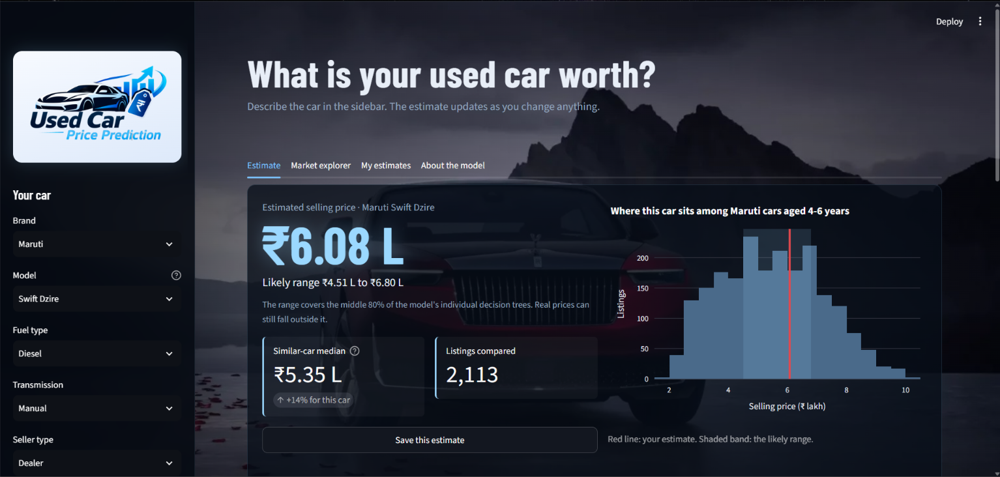
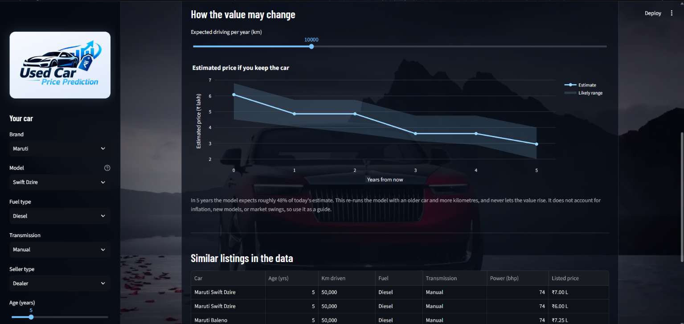
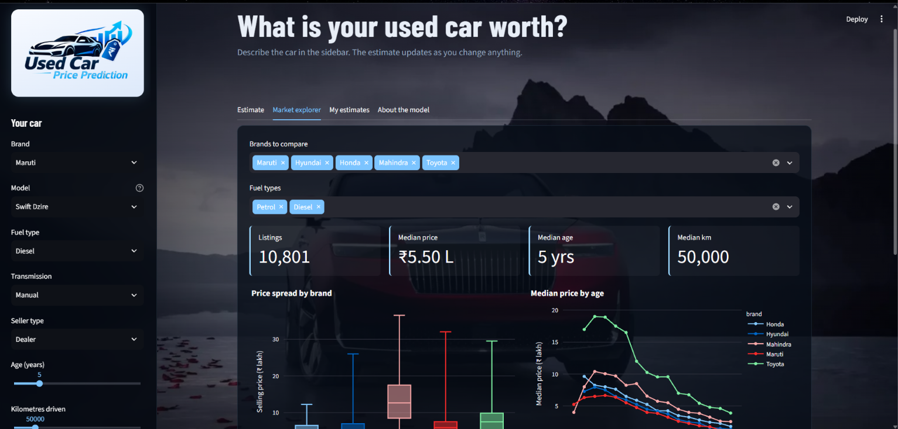

<p align="center">
  
</p>

<h3 align="center">Estimate what a used car is worth, and see how that value may change.</h3>

<p align="center">
  
  
  
</p>

---
<p align="center">
  <a href="https://used-car-price-prediction-web.streamlit.app/">
    
  </a>
</p>

## Overview

Buying or selling a used car in India usually starts with one question: *what is a fair price?* This project answers it with a machine learning model trained on about 15,000 CarDekho listings, and wraps the model in an interactive dashboard so anyone can try it without touching code.

You describe a car (brand, model, age, kilometres driven, fuel, transmission and a few specs) and the dashboard returns:

- an estimated selling price with a likely range
- how that price compares with similar cars in the data
- a 5-year forecast of how the value may change
- the closest real listings, for a sanity check

The project covers the full workflow: data cleaning, exploratory analysis, model training, evaluation, and a deployed-style app.

## Dashboard

<p align="center">
  
</p>

<p align="center">
  
</p>

<p align="center">
  
</p>

**Features**

| Tab | What it does |
|---|---|
| **Estimate** | Price estimate with a likely range, comparison against similar cars, a 5-year value forecast, and the 8 closest real listings |
| **Market explorer** | Filter by brand and fuel type to see price spread, price by age, price by transmission, and power vs price |
| **My estimates** | Save several estimates, compare them side by side, and download them as CSV |
| **About the model** | Plain-language explanation of how the model works and where it is weaker |

Other details:

- Brand, model, fuel and transmission are dropdowns, so a typo can never change the prediction silently.
- Choosing a model pre-fills its typical engine size, power, mileage and seats.
- The app warns about rare fuel types, models with very few listings, and values outside the range seen in training.
- Prices are shown in lakh and crore, the way Indian listings quote them.

## Dataset

| | |
|---|---|
| Source | Public CarDekho used-car listings dataset |
| Raw rows | 15,411 |
| Rows after cleaning | 15,409 |
| Brands / models | 32 / 120 |
| Price range | ₹40,000 to ₹3.95 crore (median ₹5.56 lakh) |
| Target | `selling_price` |
| Inputs used | brand, vehicle age, km driven, seller type, fuel type, transmission, mileage, engine, max power, seats |

Selling price is strongly right-skewed: most cars sell between ₹3 and ₹10 lakh, with a small number of luxury cars (Ferrari, Bentley, Rolls-Royce and others) far above that. These cars are real listings, so they were kept rather than removed as outliers.

## Approach

1. **Data cleaning and EDA** (`Notebook/data_cleaning.ipynb`): check quality, clean columns, explore price against age, mileage, fuel, transmission and brand, then save `data/cleaned_cars.csv`.
2. **Model training** (`Notebook/model_training.ipynb`): split the data 80/20, then build one scikit-learn `Pipeline` that holds both the preprocessing and the model:
   - numeric columns: median imputation
   - categorical columns: most-frequent imputation, then one-hot encoding that ignores unseen categories
   - model: `RandomForestRegressor` (100 trees, `min_samples_leaf=3`)
3. **Saving**: the whole pipeline is saved with `joblib`, so the app applies exactly the same preprocessing as training.
4. **App** (`app.py`): a Streamlit dashboard that loads the pipeline and the cleaned data.

**A note on model size.** A fully grown Random Forest of 200 trees produced a 198 MB file, too large for GitHub. Setting `min_samples_leaf=3` and using 100 trees cut the saved model to about 9 MB, for a loss of roughly ₹3,000 in average error.

## Results

Evaluated on a held-out 20% test set (about 3,080 cars):

| Model | R² | Average error (MAE) |
|---|---|---|
| **Random Forest (used in the app)** | **0.936** | **₹97,800** |
| Linear Regression (baseline) | 0.664 | ₹2,62,000 |

- A typical car is estimated within about **10%** of its listed price (median absolute percentage error 10.2%).
- **Most influential inputs:** max power (about 75% of the importance), vehicle age (14%), then kilometres driven (5%).

**Error by price band**

| Price band | Cars in test set | Average error | Typical error |
|---|---|---|---|
| Under ₹3 lakh | 435 | ₹43,000 | 16.5% |
| ₹3 to 6 lakh | 1,246 | ₹57,000 | 10.2% |
| ₹6 to 10 lakh | 895 | ₹83,000 | 8.8% |
| ₹10 to 20 lakh | 361 | ₹1.69 lakh | 9.4% |
| Over ₹20 lakh | 145 | ₹5.29 lakh | 11.6% |

**How much to trust the score.** The single-split R² of 0.94 is the best case. Averaged over five different train/test splits, R² is about **0.87** (spread of ±0.08), because a handful of very expensive cars can swing the score depending on which split they land in. For everyday cars between ₹3 and ₹10 lakh, the model is considerably more reliable than for rare luxury cars.

## Limitations

- **Luxury and rare cars:** there are few of them to learn from, so errors are large in rupees.
- **Rare fuel types:** the data has only 4 electric cars and 44 LPG cars, so estimates for them are rough. The app warns about this.
- **Inputs the model never sees:** condition, accident history, service records, colour, city, and current market demand.
- **The 5-year forecast** re-runs the model with an older car and more kilometres. It is a guide, not a market prediction, and it ignores inflation and new model launches.
- This is an estimate to start a price conversation, not a formal valuation.

## Next steps

- Remove the 167 duplicate rows before splitting the data, so no listing appears in both train and test.
- Decide how to treat extreme `km_driven` values (a few listings exceed 500,000 km).
- Compare Gradient Boosting models and a log-transformed target, using cross-validation.
- Add the car model name as a feature and test whether it helps.

## Project structure

```
Used-Car-Prediction/
├── app.py                      # Streamlit dashboard
├── requirements.txt
├── .streamlit/
│   └── config.toml             # dark theme
├── Notebook/
│   ├── data_cleaning.ipynb     # cleaning and EDA
│   └── model_training.ipynb    # pipeline, training, evaluation, saving
├── data/
│   ├── cardekho.csv            # raw data
│   └── cleaned_cars.csv        # cleaned data used by the model and app
├── model/
│   └── car_price_pipeline.pkl  # trained pipeline 
├── assets/                     # logo and background image
└── screenshots/                # images used in this README
```

## Run it locally

You need Python 3.11 or newer.

```bash
# 1. Clone the repo
git clone https://github.com/Tanishq1222/Used-Car-Prediction.git
cd Used-Car-Prediction

# 2. Create and activate a virtual environment
python -m venv .venv
.venv\Scripts\activate          # Windows
# source .venv/bin/activate     # Mac / Linux

# 3. Install the libraries
pip install -r requirements.txt

# 4. Start the dashboard
streamlit run app.py
```

The app opens at `http://localhost:8501`.

**To retrain the model**, install Jupyter (`pip install jupyter`), open the notebooks from inside the `Notebook/` folder, and run `data_cleaning.ipynb` and then `model_training.ipynb`. The second notebook saves a new `model/car_price_pipeline.pkl`.

> The saved model only loads reliably with the same scikit-learn version it was trained with, which is pinned in `requirements.txt`.

## Tools used

Python, pandas, NumPy, scikit-learn, Plotly, Streamlit, Matplotlib, Seaborn.

## Author

Built by **Tanishq** · [GitHub](https://github.com/Tanishq1222)
